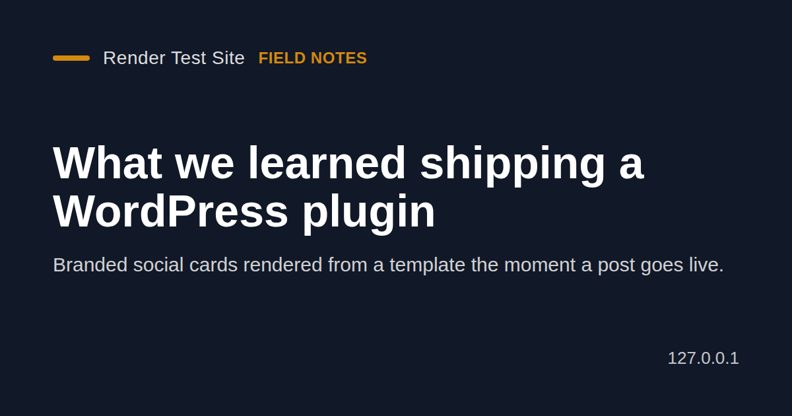
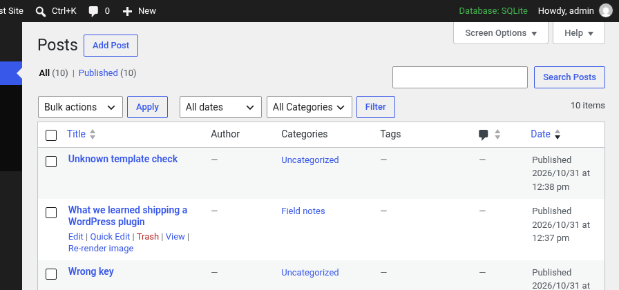
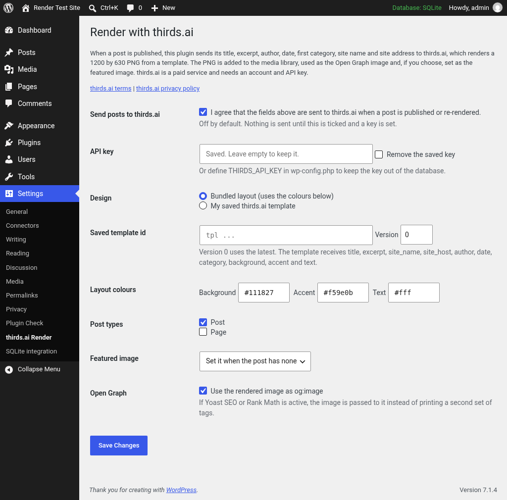

(Disclosure: I'm connected to thirds.ai.)
Drafted with AI help.

# Render with thirds.ai

A WordPress plugin that gives every post a branded 1200 by 630 social image when it is published. The image is rendered by thirds.ai from a bundled layout in your colours, or from a template you saved in your thirds.ai account. It is added to the media library, set as the featured image if the post has none, and used as the og:image for link previews.



## Two examples

**1.** You publish "Ten things we learned this year". A few seconds later the post has a PNG card with your site name, the title and the excerpt in your colours. It is in the media library, it is the featured image (if the post had none), and it is the og:image that link previews use.

**2.** You fix a typo in a title. Click **Re-render image** in the post's thirds.ai image box or in the posts list (not yet live-tested). The card is rendered again, the old one is removed and the new one takes its place.



## Install

1. Download `Source code (zip)` from the [v0.1.0 release](https://github.com/thirdsai/render-with-thirds-ai/releases/tag/v0.1.0), unzip it, and rename the folder to `render-with-thirds-ai`. Or clone it straight into your plugins folder:

   ```bash
   cd wp-content/plugins
   git clone --branch v0.1.0 https://github.com/thirdsai/render-with-thirds-ai.git
   ```

2. Activate **Render with thirds.ai** in Plugins.
3. Go to Settings > thirds.ai Render.
4. Enter your API key, or add `define( 'THIRDS_API_KEY', 'your key' );` to wp-config.php.
5. Tick "Send posts to thirds.ai", pick the post types and save.



Requires WordPress 6.5 or later and PHP 7.4 or later. This plugin needs a thirds.ai account and an API key: [thirds.ai](https://thirds.ai/?utm_source=github&utm_medium=listing&utm_campaign=own-content&utm_content=wp-render).

## External service

The plugin makes no requests of any kind until you tick "Send posts to thirds.ai" and set an API key. After that it contacts the thirds.ai API only when a post of a chosen type is published for the first time (from a background WP-Cron event) and when you click **Re-render image**.

Each render sends the post title, the excerpt (or the first 24 words of the content), the author display name, the publish date, the first category name, the site name, the site host name, your three layout colours, and either the bundled HTML layout or your saved template id. The API key goes in the Authorization header. Nothing else is sent. Each successful render uses thirds.ai credits. See the [terms](https://thirds.ai/terms) and [privacy policy](https://thirds.ai/privacy).

## What has been tested

Tested against the live thirds.ai API on WordPress 7.1.4 with PHP 8.4, the key set by the `THIRDS_API_KEY` constant and the bundled layout:

* Publishing a post renders a 1200 by 630 PNG in the background, adds it to the media library and sets it as the featured image.
* The post page then carries og:image, og:image:width, og:image:height and twitter:image for that PNG.
* Publishing the post again renders a new image and removes the old one.
* An unknown saved template id shows the API's error in the post's thirds.ai image box.

Not yet live-tested (checked only with a local stand in for the API): the Re-render button and row action, a successful saved template render, a key saved on the settings page, failed renders, and the hand off to Yoast SEO 28.8 and Rank Math 1.0.280.

Untested: multisite, PHP versions other than 8.4, WordPress versions other than 7.1.4, object caches, and other SEO plugins.

Plugin Check 2.1.0 reports 0 errors and 0 warnings.

## Files

The plugin files sit at the repository root. `readme.txt` is the WordPress.org readme. `.wordpress-org/` holds the banner, icon and screenshots for the plugin directory and is not needed to run the plugin.

## License

GPLv2 or later. See [LICENSE](LICENSE).
